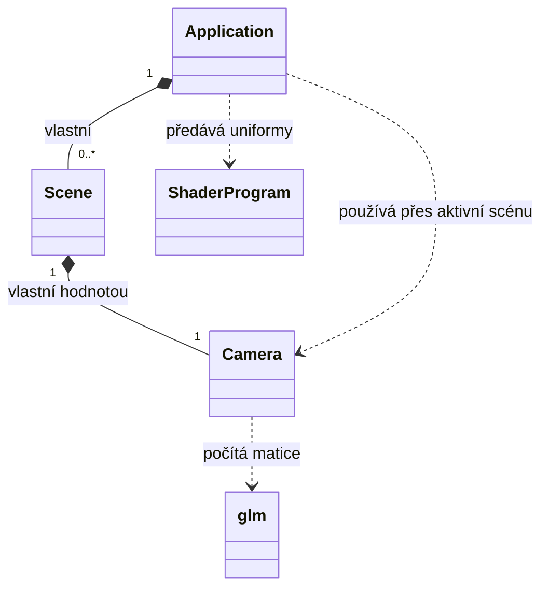

# Kamera v ZPG: vlastnictví, pohled/projekce a tok aktualizací

**Stav:** 2026-11-05, GitHub `3b218847cb64949c33ee4575c884aaa0c904b6b2`. Návrhový model + ověřený zdrojový stav, nikoli důkaz běhového testu.

## Mentální model (co a proč)

Kamera je **stav pozorovatele**, ne GPU zdroj. Uchovává `position`, `direction`, `up` a parametry projekce `fov`, `aspectRatio`, `near`, `far`. Její výsledné matice se odvozují z tohoto stavu: `view = glm::lookAt(position, position + direction, up)`, `projection = glm::perspective(radians(fov), aspectRatio, near, far)`. Vektor `direction` není bod `target`; pro míření na daný světový bod platí `normalize(target-position)`. Nulový `direction` nevytváří platný směr pohledu.

Kamera jako C++ objekt nevyžaduje speciální cleanup OpenGL prostředků. To **neznamená**, že nemá vlastníka: její stav musí mít smysluplnou životnost.

## UML a C++: dvě roviny stejného rozhodnutí



V aktuálním projektu:

```cpp
class Scene {
    Camera camera;             // kompozice: vlastní instance
public:
    Scene(const Camera& initial) : camera(initial) {}
    Camera& getCamera() { return camera; } // nevlastnící přístup k této instanci
};
```

- **Člen `Camera camera`** drží samostatnou identitu uvnitř `Scene`. Když zanikne scéna, zanikne kamera.
- **Parametr `const Camera&`** pouze čte počáteční zdroj; `camera(initial)` vytvoří kopii do vlastněného členu. Jediná lokální počáteční kamera proto může inicializovat tři nezávislé scény.
- **Návratový `Camera&`** nevrací kopii ani vlastnictví; klient pracuje přímo s kamerou uvnitř scény. Reference je platná pouze během života dané scény.
- **Nesprávné `Camera& camera` jako člen** v původní verzi scén odkazovalo na lokální kameru vytvořenou v `Application::createResources()`; po návratu z funkce zůstaly visící reference. Samotný `Camera&` vlastnictví nezajistí.
- **`std::unique_ptr<Camera>`** by také mohl vyjadřovat kompozici, ale není zde potřeba dynamické vytvoření, výměna, volitelná nepřítomnost nebo polymorfismus. Volbu mechanismu odvozujeme ze sémantiky a lifetime, ne obráceně.

## Kdo dělá co: od okna ke GPU

```text
GLFW framebuffer resize
  -> Application callback (zjistí nové rozměry)
      -> glViewport (OpenGL vykreslovací oblast)
      -> Camera::resize(width, height) pro všechny relevantní scény
          -> aktualizace aspectRatio (CPU stav)

Application::run() [každý snímek]
  -> zvolí aktivní Scene
  -> Scene::update(time)
  -> Camera::getViewMatrix(), getProjectionMatrix() [CPU výpočet]
  -> ShaderProgram::use() + setMat4(...) [přenos uniformů na GPU]
  -> Scene::draw() [GPU použije matice při vykreslení]
```

**Pozor na rozdíl mezi cílovým návrhem a stavem kódu:** současný callback dělá pouze `glViewport`; `Camera::resize` se zatím nevolá. Matice se ale již nahrávají v každém snímku. Při přechodu na čtyři osvětlovací shader programy musí být view/projection aktuální v každém programu, který danou scénu vykresluje.

**Proč nyní ne Observer:** při jednoduchém render loop stačí pravidelně přečíst aktuální stav, bez registrace a životnosti subscriberů. Observer dává smysl, až když konkrétní potřeba ukáže výhodu notifikací.

**Výstup `glViewport` ≠ projekce:** změna viewportu sama neopraví `aspectRatio`; změna projekce sama neupraví vykreslovací oblast. Pro HiDPI zařízení preferuj framebuffer-size callback a nezapomeň na nulovou výšku minimalizovaného framebufferu.

## Přenositelné zásady

1. **Návrhový vztah je první, C++ mechanismus druhý:** UML kompozice je vlastnictví a životnost, ne povinně `unique_ptr`.
2. **Parametr vs. uložený člen vs. návratová reference** vyjadřují jiné role. Vlastnictví se rozhoduje v místě uložení, nikoli volbou `&` v signatuře konstruktoru.
3. **Změna CPU stavu ≠ změna GPU stavu.** Po změně kamery je potřeba nové uniformy nahrát ve správném shader programu před kreslením.
4. **Hlavička tvoří část závislostního grafu.** Hodnotový člen potřebuje úplnou definici typu. Nadbytečná závislost `Camera.h -> GLFW` vedla ke konfliktu `GL/gl.h` vs. GLAD v jiných překladových jednotkách.
5. **Koordinátor řídí kdy, specializovaný objekt ví jak:** `Application` řeší GLFW a pořadí render loop, `Camera` matematiku, `ShaderProgram` GL uniformy.

## Otevřené ověřovací úkoly

- Při resize širokého a úzkého framebufferu zůstává koule kulatá; výška 0 nevede k dělení nulou.
- Dvě scény začínají s různou kamerou; přepnutí změní pohled, aniž by si scény přepisovaly stav.
- Pozorovatel s kamerou se pohybuje WASD a rozhlíží myší; lze vysvětlit `direction`, `right`, `up`, yaw/pitch a závislost na `deltaTime`.
- Build a běh opraveného stavu ještě nejsou doložené asistentem.
