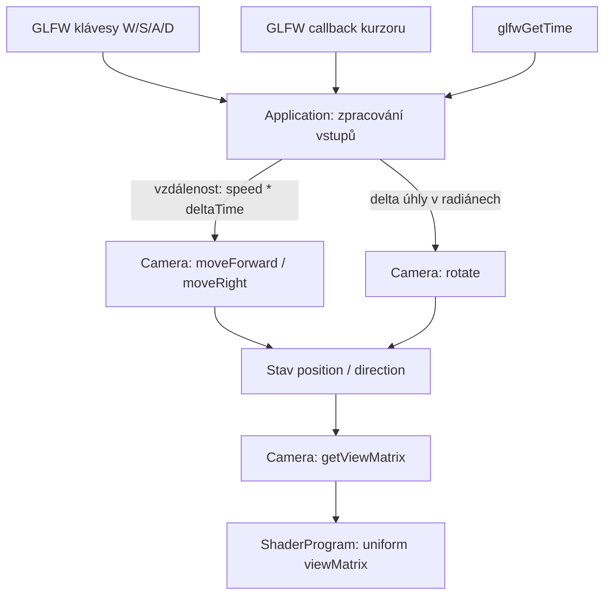

# Ovládání kamery: vstupní události, čas, kurzor a orientace

**Ověřený GitHub HEAD:** `5a972baa559fa0a661e2cbec221962b229bdd34a` (2026-11-09). **Běh:** uživatel potvrdil funkčnost WASD + myši; asistent provedl pouze kontrolu zdrojů.

## Rozdělení odpovědností



`Camera` **nezná GLFW**, konkrétní klávesy ani jednotky pixelů. `Application` interpretuje vstup; `Camera` pouze transformuje vlastní stav. Zatím není dost důvodů pro samostatnou třídu `CameraController` nebo Observer.

## Proč polling W/S/A/D a callback myši

`glfwGetKey` zjišťuje, zda je klávesa **držena**; proto je přirozené jej kontrolovat ve vykreslovací smyčce a posouvat kameru podle uplynulého času:

```cpp
double lastTime = glfwGetTime();
// opakovaně:
double now = glfwGetTime();
float dt = static_cast<float>(now - lastTime);
lastTime = now;
// při W: camera.moveForward(speed * dt)
// při S: camera.moveForward(-speed * dt)
```

`glfwSetCursorPosCallback` naproti tomu dodává nové souřadnice kurzoru **při událostech**. Jednorázová první událost nastaví výchozí pozici, další události vypočítají změnu:

```text
firstMouse ? uložit (x,y) : deltaX = x - lastX, deltaY = y - lastY
deltaYaw   =  deltaX * radians(0.1° na pixel)
deltaPitch = -deltaY * radians(0.1° na pixel)
camera.rotate(deltaYaw, deltaPitch)
lastX = x; lastY = y
```

Poslední dvě přiřazení musí proběhnout po **každé** zpracované změně; jinak se delta stále měří od prvního bodu a při opakovaném přičítání se úhel přehání.

`GLFW_CURSOR_DISABLED` kurzor skryje a umožní trvalé relativní otáčení bez hran okna. `GLFW_CURSOR_NORMAL` jej při budoucím přepínání režimu vrátí. Při obnovení režimu/fokusu se vyplatí znovu nastavit `firstMouse`, aby nevznikl skok.

## Vektory pohybu ≠ směr pohledu

Kamera reprezentuje `direction` v prostoru (včetně svislé složky). Pro chůzi v rovině XZ:

```cpp
glm::vec3 forward = normalize(vec3(direction.x, 0, direction.z));
glm::vec3 right   = normalize(cross(forward, up));
position += forward * distance; // W/S
position += right   * distance; // D/A
```

V orientaci s `up=(0,1,0)` je `right` vodorovný a kolmý na `forward`; pořadí v `cross` rozhoduje o znaménku. Pro volné létání by se naopak mohl pohybovat podél celé `direction`.

Při současném W+D se přičtou dva kolmice jednotkové vektory a výsledná rychlost je přibližně `sqrt(2)` rychlosti jednoho směru. Lze později normalizovat výsledný směr pohybu, pokud to odpovídá požadovanému chování.

## Orientace s jediným zdrojem pravdy

Při zachování `direction` jako jediného uloženého stavu orientace:

```text
yaw   = atan2(direction.z, direction.x)
pitch = asin(direction.y)
yaw += deltaYaw
pitch = clamp(pitch + deltaPitch, radians(-89), radians(89))
direction = (cos(pitch)*cos(yaw), sin(pitch), cos(pitch)*sin(yaw))
```

Všechny úhly z GLM trigonometrie jsou **v radiánech**, kdežto kurzor posílá **pixely**; `sensitivity` je převodní koeficient. `atan2` respektuje kvadrant; pro `asin(direction.y)` předpokládáme normalizovaný `direction`. Omezení pitch chrání před degenerací přesně svislého pohledu při běžném `rotate`, ale konstruktor dnes ještě přijímá i nekorektní směry.

## Vlastnictví a životnost

`Application` vlastní scénu přes `unique_ptr<Scene>`; `getActiveScene(): Scene&` je **nevlastnící reference**. Výraz `*scenes[index]` vrací existující objekt (lvalue). Kdyby getter vracel `Scene` hodnotou, pro aktuální tělo funkce by se musela vytvořit kopie scény, která ale obsahuje `vector<unique_ptr<...>>` a není standardně kopírovatelná. Reference je platná jen do zániku scény.

Naopak `Application` má **vlastní členy** `lastMouseX`, `lastMouseY`, `firstMouse`: informace musí přežít callback. Pomocné `deltaX`, `deltaY` jsou lokální.

## Zobecnění

1. **Odděl mechanismus události od doménové operace:** vstup `GLFW_KEY_W` není odpovědnost kamery; ta rozumí požadavku na posun o vzdálenost.
2. **Inkrementální výpočet vyžaduje aktualizovanou paměť poslední hodnoty:** bez `last = current` nepočítáme změnu oproti minulé události.
3. **Rozlišuj jednotky, orientaci os a zdroj pravdy:** pixel != radián; `direction` != `forward` omezený na rovinu; úhly jsou odvozené, ne paralelně ukládané hodnoty.
4. **Stavový model omezuje potřebné návrhové vzory:** když `Application` zajišťuje vstup a `Camera` matematiku, další třída vznikne až při skutečné komplexitě.

## Zbývající ověření

Konstantní diagonální rychlost, singularita XZ projekce, refocus/znovu-zachycení myši, skutečné startovní rozměry framebufferu a přenos view/projection do více shader programů. Tyto otázky nevydávat za hotové řešení.
